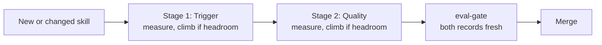
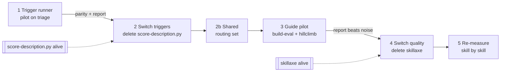

# Plan — move skill measurement onto build-eval and hillclimb

Status: in progress, phase 1 · Owner: the marketplace maintainer · Started: 2026-10-16

Now: phase 2, PR A, is written on `feat/hillclimb-trigger-runner` and not yet committed. It
switches the gate to the new runner and deletes `score-description.py`. It waits on one end-to-end
run, `meta:skill-eval` measured and saved through the new path, which needs the maintainer to
approve the harness. PR B, steps 6–7 of phase 2, follows: the one entry point and the new gate
requirements.

## Goal

Replace BladeForge's home-grown improvement loop with Claude Code's `/claude-api build-eval` and
`/claude-api hillclimb`, and keep only the parts that are ours by necessity. The switch is gradual:
the new path runs beside the old one, has to match it, and only then does the old one go.

## Why

Our current loop measures and rewrites on the same cases, and it does not know its own noise.

- `score-description.py --suggest` and `meta:update-skill` rewrite a description against the same
  `rubric.json` it is then scored on. A gain there can be fitting to the cases, not a better skill.
- No measurement checks that the run-to-run noise is smaller than the change we act on. With
  `--runs 5` on 18 cases, a move from 9/18 to 11/18 may be chance.
- `skillcraft:skillaxe` judges one task per skill, run once with the guide and once without. All 45
  `acceptance` blocks in `result.json` rest on that single task, so none of them can tell a real
  effect from zero.
- Nobody has checked the skillaxe judge against a human verdict.

Hillclimb closes all four gaps. It splits cases at random into train and test. It checks noise before
round one, makes one change per round, and reverts a change when test does not improve. Its final
report carries a confidence interval. Anthropic's write-up names skill triggering as one of the
places hillclimb has worked well.

## What stays ours, what moves

The hillclimb runner is a scaffold, `run-eval.mjs`, bundled in Claude Code. We copy it and fill in
three functions: `loadCases`, `runCase`, `gradeCase`. The loop, reps, resume, the report and
`trajectory/scores.tsv` come with the scaffold.

| piece | today | after |
|---|---|---|
| trigger cases | `rubric.json` `trigger` half | same file, read by `loadCases` |
| trigger measurement: install as a real `.claude/skills/<name>/`, count a hit when `Skill` fires | `score-description.py` `_write_skill`, `_fired` | `runCase` + `gradeCase`, ours |
| loop, accuracy, verdict, report | `score-description.py` | hillclimb |
| description rewrite | `--suggest`, `diagnose_misses` | hillclimb rounds |
| description and queryset hashes for CI | `score-description.py --print-description-hash` | a small Node hash script, ours |
| merge gate | `scripts/eval-gate.sh` | unchanged, ours |
| guide-skill tasks | one task per skill, in the skillaxe run | 15+ cases from `build-eval` |
| guide-skill judge | skillaxe LLM judge against `acceptance` | build-eval pairwise judge; the `acceptance` items are its checkable claims |
| baseline isolated from the repo | skillaxe protocol | `runCase` variant `without-guide`, ours |
| must-survive list before a rewrite | skillaxe anchor, kept by the agent | one case per item, so a revert catches the loss |
| embedding axes | skillaxe, optional | dropped |

## The skill pipeline — two measured stages

Every skill passes two separate stages, and each one has its own cases, its own score and its own
climb. They answer different questions, so a skill can pass one and fail the other.

| stage | question | cases | grader | climbs |
|---|---|---|---|---|
| 1. Trigger | does the skill fire when it should, and stay quiet otherwise? | `rubric.json` `trigger` queries | programmatic: did `Skill` fire for this skill | the `description:` line |
| 2. Quality | once it fired, does the agent do the job better than without it? | 15+ tasks from `build-eval` | pairwise LLM judge on the `acceptance` items | the skill body and `references/` |

The first measurements show why the stages are separate. On `claude-opus-5-5` stage 1 is
saturated for the skills measured so far, so the useful climbing is expected in stage 2. The gate
demands a fresh record for both stages, and phase 4 adds the stage-2 record.

## Phases

Each phase is one PR. The old tool stays alive until the next phase's exit check passes, so any phase
can be rolled back by reverting its PR alone.

### Phase 1 — trigger runner, piloted on `meta:triage`

`meta:triage` scores 9/18 today, the most headroom of any skill.

1. Copy the scaffold to `scripts/hillclimb/trigger-runner.mjs`.
2. Fill `loadCases` from `<skill>/evals/rubric.json` `trigger`.
3. Fill `runCase`: install the skill into a temp project as `.claude/skills/<name>/`, run
   `claude -p --output-format stream-json`, return the transcript plus `model` and `usage` from the
   stream. `ctx.variant` selects which description is under test.
4. Fill `gradeCase`: `pass = fired === should_trigger`.
5. Gitignore the flow dirs, `.claude/hillclimb/*/`. Traces stay local.
6. Run the baseline with both tools, `--reps 5` each, and compare.
7. Run `/claude-api hillclimb` with the description as the only surface it may change.

Exit check:

- The new runner's baseline accuracy matches `score-description.py` within the noise that hillclimb
  measures.
- Hillclimb produces a report with a test-set confidence interval.
- If hillclimb says the noise is larger than the effect, that also counts as an exit. Record it as
  the finding "18 cases is too few" and carry it into phase 5.

### Phase 2 — switch triggers, delete `score-description.py`

1. Make the runner write the same `trigger` block into `evals/result.json`, with both hashes, so
   `eval-gate.sh` and `gen_showcase.py` read it unchanged.
2. Port the hash function to `scripts/hillclimb/description-hash.mjs` and point `eval-gate.sh:141`
   at it. The gate must reproduce today's hashes byte for byte, or every saved result goes stale.
3. Update every caller and doc: `eval-gate.sh:197` and `:215`, `meta:skill-eval` `SKILL.md`,
   `meta:update-skill` `SKILL.md:221`, `meta:new-skill` `SKILL.md:328`,
   `references/authoring-best-practices.md`, `docs/authoring.md`, `docs/mechanisms/skill-eval.md`,
   `README.md`.
4. Delete `score-description.py` and `plugins/meta/tests/save-result.test.py`.
5. Keep the rule in `meta:skill-eval` that forbids skill-creator's `run_eval` and `run_loop`. It is
   still true.

6. Make the climb the default path for a NEW skill, because a freshly written description almost
   always needs it. One entry point takes a skill dir and does everything: create the flow dir with
   a seeded split (`scripts/hillclimb/new-flow.mjs`), reuse the harness approval when the runner
   file is byte-identical to an approved one, run the baseline, run the hillclimb workflow, and
   write `result.json`. `meta:new-skill` ends by calling it. Two limits must be visible to the
   author: a pass costs about 8% of a 5-hour window, so baseline plus three rounds is about a third
   of one; and the same author writes the rubric and the description, so the rubric's cases should
   come from real requests wherever they exist.

7. Make the new path required, through the gate that already blocks merges. `eval-gate.sh` already
   refuses a touched skill whose `result.json` is missing or stale, and it has no skip flag. It
   gains three checks on the `trigger` block:
   - the record came from `trigger-runner.mjs`, in the isolated environment, on
     `claude-opus-5-5`; a record from `score-description.py` counts as stale;
   - the record carries case count, reps, and the test-split confidence interval, so a number
     without its noise is refused;
   - a skill that is new on this PR also carries a `hillclimb` block: baseline test score, final
     test score, rounds run, and the verdict. "No headroom" and "gain within noise" are valid
     verdicts; a missing block is not.
   `meta:new-skill`, `meta:update-skill` and the `review` plugin's skill lens point at the one
   entry point from step 6, so the path the gate demands is the path the tools walk.

Exit check: `scripts/eval-gate.test.sh` passes, the gate stays green on a PR that touches one skill,
and `git grep score-description` finds no live instruction to run it. Historical mentions that
explain the defect stay, in `docs/mechanisms/skill-eval.md`, `meta:skill-eval` and the diagram
skill's `RESULTS.md`.

### Phase 2b — one shared routing set for every skill

Per-skill trigger cases saturate. On `claude-opus-5-5` the measured skills pass 94–100%, and with
4–7 test cases the noise is ±18–22 points. Growing every rubric to about 60 cases would bring the
noise to about ±10, but at 45 skills one full pass would cost several 5-hour windows.

A shared set is cheaper, because one query exercises every skill at once. In crowded mode a run
already reports which skill fired, so a query labelled with its owner measures routing for the
whole marketplace in one pass.

1. **Build the pool.** Each case is `{"query", "owner"}`, where `owner` is a `<plugin>:<skill>` id
   or `none` for a query no skill should take. Seed it from every rubric: a should-trigger query
   is owned by its skill. A should-not-trigger query becomes a `none` case unless another skill owns
   it. The pool lives in one file, `evals/routing.json` at the repo root.
2. **Add hard cases from the boundaries first.** These are queries where two skills compete, found
   where crowded runs showed a sibling taking a query. Example: Apex assertions, between
   `tests:architecture` and `tests:apex`. Real requests come before invented ones wherever they
   exist.
3. **Grade per run:** pass when exactly the owner fired, or nothing fired for a `none` case. Report
   a per-skill score with its interval, and a confusion table of owner against what actually fired.
   The table shows which pairs of skills steal from each other.
4. **The freeze rule, restated for a growing set.** Existing cases are never edited or deleted.
   New cases are only added, and each one is assigned to train or test at random, by seed, when it
   is added. A case can be retired only when its owner skill is deleted. The pool hash moves on
   every addition, so the gate sees the change.
5. **Price one pass before building on it.** Run 20 cases first and show the cost table. The pool
   size and the rep count follow from that number.

Exit check: one crowded pass over the pool produces per-skill scores and a confusion table. At
least one boundary pair shows real headroom above noise, which gives hillclimb something to climb.

### Phase 3 — guide-skill pilot

Pick the guide skill when the phase starts. My lean is `git:commit`. It runs every day, so real
transcripts exist, and build-eval takes cases from transcripts first.

1. Run `/claude-api build-eval` on the chosen skill. Target 15 or more cases.
2. Pass every case through `cerberus:leak-check` before it lands in git. Raw transcripts come from
   client work and never get committed.
3. Grader: pairwise LLM judge against a frozen baseline; the skill's `acceptance` items are its
   claims.
4. The maintainer does the build-eval grader check: reads the scored sample and marks any verdict
   they would have given differently.
5. Turn the must-survive list into cases.
6. Run `/claude-api hillclimb` with `SKILL.md` and `references/` as the surface it may change.

Exit check: build-eval's checks pass, meaning the grader agrees with itself on a rerun and the
baseline is below 95%. Hillclimb's report shows a test gain above noise, or states plainly that
there is none.

### Phase 4 — switch quality, delete skillaxe

1. The quality flow writes an `acceptance` block into `result.json` that carries case count, reps
   and confidence interval.
2. Remove the 45 single-task `acceptance` blocks. Until a skill is re-measured, the showcase shows
   it as not measured. That is the honest state, because a number from one task means nothing.
3. Update `scripts/gen_showcase.py:110` and the journal article
   `showcase/journal/the-measurement.html`.
4. Delete `plugins/skillcraft/` and its `README.md` and `marketplace.json` entries. It holds no
   other skill.
5. Keep `scripts/validate_acceptance.py` and gate step 5. They check only that `rubric.json`
   carries an `acceptance` list, which stays the judge's input.

Exit check: `grep -r skillaxe` finds nothing outside history, and `scout-gate` and `eval-gate` pass.

### Phase 5 — re-measure

Re-run triggers, lowest score first: `meta:triage`, `salesforce:sf-deploy-test`,
`meta:wittgenstein`, `git:commit`, `tests:architecture`. Raise case counts to whatever phase 1
showed the noise needs. Re-run quality skill by skill, starting with the most used.

## Cross-cutting rules

- **Cost before fan-out.** Before running more than one skill, measure one unit, show the cost
  table, and follow `meta:model-routing`.
- **Leaks.** Cases, traces and reports pass `cerberus:leak-check` before they are committed. Flow
  dirs with raw traces stay gitignored.
- **Human approval for the runner.** The scaffold refuses to run after its own code changes until
  someone re-approves it with `--approve-harness`. Never pre-approve it in an allowlist.

## Phase 1 findings (2026-10-16)

- **Baseline for `meta:triage` is 85/90 (0.944): train 0.917, test 1.000.** The saved score was
  9/18, measured 2026-09-08 on `sonnet` with `score-description.py`. The new runner differs in
  three ways at once, so the jump cannot be attributed to one of them: the model is
  `claude-opus-5-5`; the probe gets the description line verbatim; only a `Skill` call for the probe
  counts.
- **No headroom on test, so `triage` cannot be climbed.** Phase 1 needs another pilot skill.
- **Every saved trigger score is suspect.** `score-description.py` re-emitted the description
  unquoted. That breaks the probe's YAML for the 12 skills whose description holds `: `, and it
  leaves `—` escapes as literal text for 8 skills.
- **Cost: one 90-run pass is about 20% of a 5-hour window,** against an estimated 8%. The median run
  still wrote about 26,500 tokens to the cache under `--concurrency 8`, although sequential runs in
  a fixed directory hit the cache. The cause is not known yet.
- Answered: hillclimb accepts an existing runner (its Step 0 asks for one), and the served-model
  check passes, because `claude -p` reports `claude-opus-5-5`.
- `--approve-harness` cannot be delegated: auto mode refuses it from a subagent. The maintainer
  runs it.

- **Crowded screening, `--reps 2`, 2026-10-16:** `triage` 34/36, `sf-deploy-test` 36/36,
  `wittgenstein` 36/36, `commit` 38/38, `architecture` 40/44. All four `architecture` misses are
  should-trigger queries that a sibling took (`tests:apex`, `frontend-react:storybook-stories`).
  Its test headroom is 0.143 against a noise floor of about ±0.17 at `--reps 5`, so the climb
  would stop at its own Step 0.5. A crowded pass of 90 runs costs about 10% of a 5-hour window.
- **Conclusion: on `claude-opus-5-5` the trigger rubrics are saturated in both modes.** The low
  saved scores came from measurement defects, not from weak descriptions. Two things follow. The
  runner is still worth having as the gate's measurement, which is phase 2. The rubrics need harder
  near-miss cases taken from real requests, such as the boundary between `tests:architecture` and
  `tests:apex`, before a trigger climb can show anything.

## Decisions

- 2026-10-16: trigger scores are measured on `claude-opus-5-5`, the model the team works on.
  Triggering is model-dependent, so a cheaper model would measure something users do not see.

- 2026-10-16: the nested run is isolated with `--setting-sources project --strict-mcp-config`. It
  sees no user settings, plugins, hooks or MCP servers, only the probe skill and Claude Code's
  built-ins, so a score does not depend on the machine. A probe of 4 runs confirmed it: replies
  came back in English, so no user `CLAUDE.md` output style was loaded, and context fell from
  39,000–119,000 tokens to about 16,000. A run cost about 40% as much as in the full environment.
  `--bare` is not usable, because it requires `ANTHROPIC_API_KEY` and the team signs in with OAuth.
- Parked: a "crowded" mode that installs every marketplace skill as a probe in the same project,
  to measure whether skills steal each other's triggers. It runs less often than the isolated mode.
- **Proposed, pending the maintainer: crowded becomes the main measurement and isolated becomes a
  sanity check.** The isolated screening saturates. At `--reps 2` it scored `sf-deploy-test`,
  `wittgenstein` and `commit` 100% on train and test, and `architecture` 100% train, 0.857 test.
  The one failure was a query a sibling skill owns in production: Apex assertions belong to
  `tests:apex`, which isolation leaves out. With a single skill installed, the model only decides
  "this skill or nothing", so there is nothing left to climb. Crowded mode is implemented as
  `_state.json.environment: "crowded"`: every marketplace skill becomes a probe named
  `<plugin>-<skill>`, and a query a sibling takes counts in `fired_other`.

## Open questions

- Should the gate refuse a skill below a fixed trigger score? Lean: no. With 6–7 test cases the
  noise is about ±18 points, so a fixed bar would mostly catch noise. The gate should fail only a
  final score below the baseline, or a hillclimb record that is missing.

- Why does the prompt cache miss? In the triage baseline 89 of 90 runs were cold. The median run
  carried about 39,000 tokens of context and wrote about 26,500 of them to the cache.
