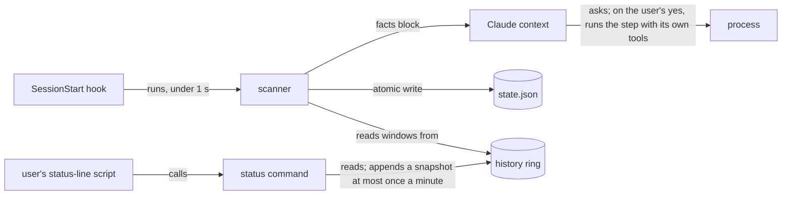

# Plan: machine-health plugin

Status: design, research done · Owner: the marketplace maintainer · Started: 2026-11-06 · Issue: RMA-371

**Decision:** a plugin that tells the user and Claude, at session start, what is slowing the machine.
v1 has four detectors and only reports: it kills nothing, deletes nothing, and proposes no fix. Working name:
`machine-health` (not final).

**v1 tells and suggests; the plugin itself executes nothing (decided 2026-11-06).**

- The SessionStart hook injects a "You should know" block, the same pattern the Whose Turn hook uses.
- Each finding carries its facts and one suggested step. For example: "`fseventsd` holds 6.1 GB
  against a 30 MB budget. Offer the user `sudo kill -TERM 331`. Run nothing without their yes."
- Claude raises the finding in its first reply and asks. On a yes it runs the step with its own
  tools, through Claude Code's normal permission prompt. A `sudo` line is for the user to run.
- Suggestions are offered only where a mistake is cheap:
  - orphaned agent processes older than 24 h;
  - the `fseventsd` restart line, which the user runs.
- Memory and disk findings are information only.

**No plugin-executed action in v1 (decided 2026-11-06, after critique round 1).** The kill path returns in v1.1, and
only when three preconditions hold:

1. a proven owner check, so a process of a live session is never a target;
2. a proof that a human, not the auto-mode classifier, said yes;
3. thresholds calibrated from the two-week log.

Until then every "fix" below is a v1.1 item.

## Why

On 2026-11-06 a 10-core Mac with 82 days of uptime was lagging. The causes were:

- swap at 16 of 17 GB, with memory pressure level 2;
- `fseventsd` at 11 GB RSS and 80–100% of a core, against a 30 MB budget;
- orphaned processes from agent sessions, two of them at 70+ CPU-hours each;
- about 290k empty temp dirs left by a test suite.

No existing tool links a process to the agent session that left it behind, and none briefs the agent.
The Claude Code tracker shows these problems are common and still growing:

| Category | Issues | Open |
|---|---|---|
| Memory leak / OOM / swap | 629 | 87 |
| Orphan processes (non-MCP) | 440 | 92 |
| CPU spin | 376 | 59 |
| Whole machine slow / freeze | 301 | 73 |
| `~/.claude` growth | 129 | 25 |
| Temp dir growth | 69 | 9 |
| Disk full / ENOSPC | 67 | 9 |

These are title-regex counts over about 5.8k issues, 2025-02 to 2026-11, so treat them as lower
bounds. Orphan reports peaked in Q3 2026.

## Shape (settled)

- **Hook:** runs the scanner and prints a short "You should know" facts block for Claude, who tells
  the user in their language. The plugin prints nothing to the user itself. The hook never acts.
- **Skill: none in v1.** The hook's block already carries the facts and the suggested step, so v1
  adds no skill. The on-demand skill arrives in v1.1, with plugin-executed actions, the proof of a
  human yes and pid re-verification. It will go through the nine `meta:new-skill` questions and a
  trigger measurement then.
- **No daemon.** A resident watcher would be one more process to blame.
- **Status line: extend, never occupy.** The plugin ships a command such as
  `machine-health status cpu,mem,swap`, and the user's own status-line script calls it. Removing
  the plugin leaves the rest of the line intact.
- **CPU % is the share of all cores, 0–100.** Load average is never shown as a percentage.
- **History comes from the status command (decided after critique round 1).** The status line runs
  constantly while a session is open, so it doubles as the sampler. There is still no daemon.
  - At most once a minute, the status command appends a snapshot to a fixed-size ring of the last 120
    snapshots. Each snapshot is 1–2 KB, so the ring is capped at about 240 KB. The oldest snapshot is
    overwritten, so nothing needs cleaning.
  - v1 keeps no per-process entries in the ring, only system values and `fseventsd`'s RSS and CPU
    time. Per-process history, keyed by `pid + start time`, arrives with the v1.1 kill path.
  - The writer takes a lock. If the lock is busy, it skips that write, and the next minute catches up.
    This also settles two sessions starting at once.
  - Detectors with a time window (D2, D4) use only the real intervals in the ring. With no history,
    they stay silent.
  - The status command prints the age of its data. On a first run, or with stale data, it prints an
    empty segment and exits 0.
  - The ring lives in a fixed per-user cache directory (`~/Library/Caches/machine-health` on macOS),
    not in the plugin's own data directory. The user's status-line script calls the binary outside
    any plugin environment, and both must find the same ring. So removing the plugin does not remove
    it (Unverified 9).

## v1 detectors

Four detectors, cut to what the 2026-11-06 incident needed (decided after critique round 1). All four
only report. The last column is what the skill may offer from v1.1, not in v1.

| # | Detector | Qualifies when | Threshold | Fix (v1.1) |
|---|---|---|---|---|
| D1 | Orphaned agent / tool processes | own uid; a known agent or test tool by its arguments (allowlist in `scanner/tools.go`); parent is launchd (pid 1); older than the grace. v1 does not walk the ancestor chain: the allowlist keeps tmux, IDE and launchd-job processes out, and the full chain check arrives with v1.1 | one grace of 24 h (zclean) until the log calibrates per-class values | kill by verified pid: TERM, 10 s, KILL, verify exit |
| D2 | Memory pressure and swap growth | pressure warn or critical on two scans at least 5 min apart, not within 3 min of wake; or swap growing between scans | mac level ≥ 2; Linux PSI `some avg60 > 10`; Windows commit > 90% | none; lists the top consumers by footprint and marks agent processes among them |
| D3 | Disk | the Data volume (`/System/Volumes/Data` on macOS) via `statfs`, which does not count purgeable space, so v1 errs towards warning. Purgeable space and temp, task `.output` and `~/.claude` counts are v1.1 | < 15% **and** < 25 GB warn; < 8% **and** < 10 GB urgent | none in v1 |
| D4 | `fseventsd` runaway (mac) | two scans at least 10 min apart; not within 15 min of a `.git/index` change in the working repo | warn > 500 MB; runaway > 2 GB or > 0.5 core across the two scans | prints the `sudo` line; the plugin never runs it |

Most numbers are proposals with no published source. Two exceptions: the 24 h grace comes from zclean,
and the `fseventsd` limits come from users' guards in claude-code #98769. Calibrate the proposals from
two weeks of logged scanner values before relying on them.

**v1.1**, held back by critique round 1:

- forgotten dev servers and tunnels: false positives behind proxies, on WebSocket-only clients, IPv6
  listeners and Docker-published ports;
- thermal Heavy and Low Power Mode: advice with no action, noise in every session;
- EDR load: only Sophos process names are verified, and the fix belongs to IT.

**Later**, because the cost is unmeasured, no threshold is sourced, or few people report them:

- per-user macOS daemons: `cloudd`, `mds`, `photoanalysisd`;
- PTY exhaustion;
- VM idle footprint against configured memory;
- inotify exhaustion;
- fd pressure;
- Windows and Linux service bloat;
- a workspace inside a synced folder;
- fork storms;
- uptime, used only as a modifier on other signals.

## Never

- Kill by pattern (`pkill -f`, `killall`). Kill only by pid, after re-checking pid, start time, exe
  and argv hash. Claude Code #90070 shows `pkill -f next-server` killing a sibling project's server.
- Select a target on CPU, RSS or `PPID == 1` alone. Two shipped killers retreated from that rule.
- Touch the current session, its ancestors, another uid, root, system / security / UI processes,
  VMs, `ssh-agent`, `gpg-agent`, language servers, CI runners or database services.
- Delete on mtime alone. Delete Archives, Docker volumes, VM disks, git worktrees with changes, or
  backups. Use `rm` where Trash exists.
- Run `docker system prune -a --volumes`, `wsl --unregister`, `git clean -fdx`, or `rm -rf` on a
  computed path.
- Propose a fix on a managed machine, or touch EDR or Defender exclusions.
- Chain a second fix after one yes, or propose again something the user refused in this session.
- Fail open. Any read error means propose nothing.

## Privacy

Hook output enters Claude's context, is saved in the transcript, and is replayed on resume.

- **No real name reaches Claude (decided after critique round 1).** A process is rendered only as a
  `tool id` from the plugin's own allowlist, such as `vitest`, `next-dev` or `fseventsd`. An unknown
  process is rendered as `unknown #<pid>`. Nothing else is shown about it except numbers: age, CPU and
  footprint. Process names and file names can carry prompt injection, and a name that is never
  printed cannot inject. A character filter would not stop an attack written in plain words.
- Never render argv, env, cwd, paths, ports, the host name, the user name, or the EDR vendor.
- Never read `/proc/*/environ`, `ps eww` or temp-file contents. Count and stat only.
- No telemetry. The only network calls are `/machine-health:install` and `/machine-health:update`,
  run by the user. They download the pinned binary and send no user data. `state.json`, the history
  ring and the log are mode 0600.

## Measurement

| Read | Source | Cost on the Mac |
|---|---|---|
| Process table | `KERN_PROC_ALL` / `/proc` / Toolhelp | 0.14 s for 716 procs via `ps` |
| Memory per process | `proc_pid_rusage` footprint; `ps` RSS is up to 12× low | 0.056 ms per pid |
| CPU busy % | system tick delta against the previous snapshot in `state.json`; never `ps %cpu` | microseconds |
| Listeners | `netstat -anv -p tcp` / `/proc/net/tcp` / `GetExtendedTcpTable` | 0.05 s |
| Pressure, thermal | sysctl, PSI, notify key | about 0.1 ms |

Kept out of the hook: `du` (11.8 s measured), `lsof` over the whole box (0.85 s), `docker` and
`colima` (0.8–2.3 s, and they can start a stopped VM), `systemextensionsctl` and `profiles` (0.4–0.55 s).

## Language and distribution

- **Go (decided 2026-11-06), because it is the simplest to write and to build.** It needs no runtime
  on the user's machine. It cross-compiles to all six targets without cgo through `x/sys` and
  `purego`, and it starts in about 5 ms. Rust starts about 4 ms faster, which does not matter here,
  and it is harder to write and to cross-build for macOS. Node needs a runtime and starts in
  35–50 ms, too slow for a command the status line runs on every update. The language rule this rests
  on is RMA-370. v1 does not use `gopsutil`: it lacks pressure level, thermal level and footprint, and `x/sys` plus
  `purego` cover what v1 reads.
- **The hook never downloads (decided after critique round 1).** If the binary is missing, the hook
  tells Claude to ask the user to run `/machine-health:install`, and exits within milliseconds. No binary is committed.
- **Pinned by the plugin.** The Go source lives in the plugin. A PR that changes it builds the
  binaries in CI for darwin, linux and windows on amd64 and arm64, and commits `bin.lock.json` with
  the binary version and one SHA-256 per platform. (RMA-380, not in v1: v1 ships an empty `bin.lock.json`, and install builds from source.) CI fails if the file does not match its own
  build. On merge, a release workflow builds the same binaries and uploads them under that version.
  The hashes are the trust root, and they pass review in the PR. They never sit only beside the
  binary they check.
- **Explicit commands:**
  - `/machine-health:install` downloads the version in `bin.lock.json` from the pinned release URL.
    It checks the hash before it puts the binary in place.
  - `/machine-health:update` does the same for a newer `bin.lock.json`. It replaces the binary
    atomically and keeps only the current version.
- **Updates.** `claude plugin update` brings a new plugin version with its new `bin.lock.json`.
  - If the installed binary's version differs from `bin.lock.json`, the hook tells Claude to suggest
    `/machine-health:update`, and keeps using the old binary.
  - If the old binary's output format is incompatible, the hook stays silent until the update.
  - Skill and hook text update with the plugin alone and need no binary.
- **Network.** These two commands are the plugin's only network calls. They send no user data.
- `cerberus:security-scan` will look at the download path. Dry-run it before the first publish.

## Unverified (check before relying)

1. **Answered for macOS by a spike (2026-11-06, Go 1.27.3, `purego` v0.11.3, `x/sys` v0.49.0).**
   - A `CGO_ENABLED=0 -trimpath` darwin/arm64 build works: a 3.8 MB binary.
   - `hyperfine` measured 6.8 ± 1.9 ms wall time for the whole scan.
   - The spike read pressure level, `vm.swapusage`, the process table (606 processes) and the
     thermal key.
   - Footprint via `proc_pid_rusage` worked for all 408 own-uid processes in 5 ms.
   - Footprint and `PROC_PIDTASKINFO` are both **denied** for root `fseventsd`. D4 therefore reads its
     RSS from `/bin/ps`, which is setuid root: `ps -o rss= -p <pid>` for that one pid, about 13 ms.
   - The thermal key read 0 after the machine cooled, where it read 2 earlier that day, so it does
     return to Nominal.
   - Still open: the CI matrix for linux and windows.
2. The scanner stays under 1 s on Linux and Windows. Both are unmeasured.
3. The rest of the macOS semantics:
   - whether `netstat` pid output is stable across macOS versions;
   - whether a browser HMR socket stays ESTABLISHED for the whole life of the tab.
4. Windows behaviour:
   - whether `vmmemWSL` memory and `Get-MpComputerStatus` are readable without admin;
   - the meaning of `CallNtPowerInformation` `MhzLimit`.
5. EDR process names. Only Sophos is verified.
6. Whether a Claude session registry exists, so "a live session owns it" can be checked directly.
7. How Claude Code handles a facts block that contains hostile process names. Needs an injection test.
8. Every proposed threshold, calibrated from the two-week log.
9. Whether Claude Code deletes a plugin's data directory on uninstall. If it does not, ship a
   `machine-health uninstall` command and name the directory in the README.
10. The Go build is reproducible (`-trimpath`, one pinned toolchain), so the binaries in the release
    match the hashes the PR committed. Check it by building twice in CI and diffing the hashes.
